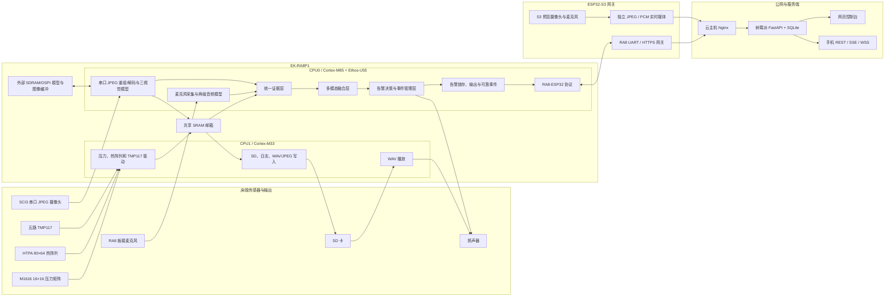
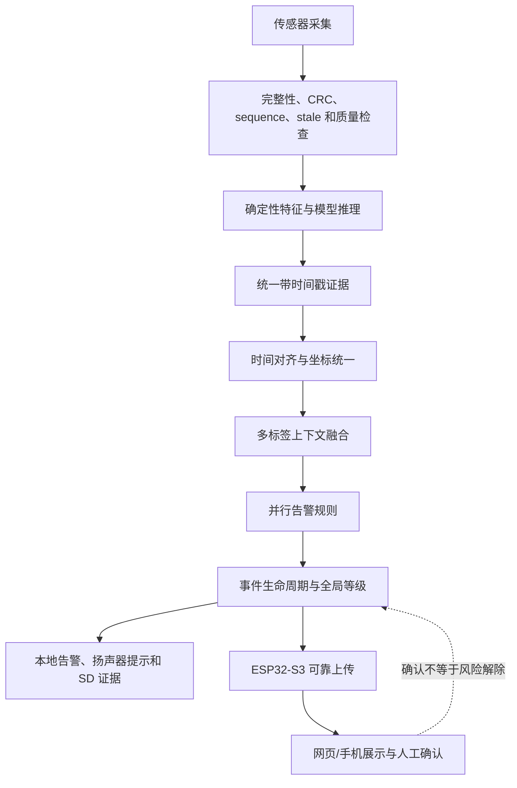
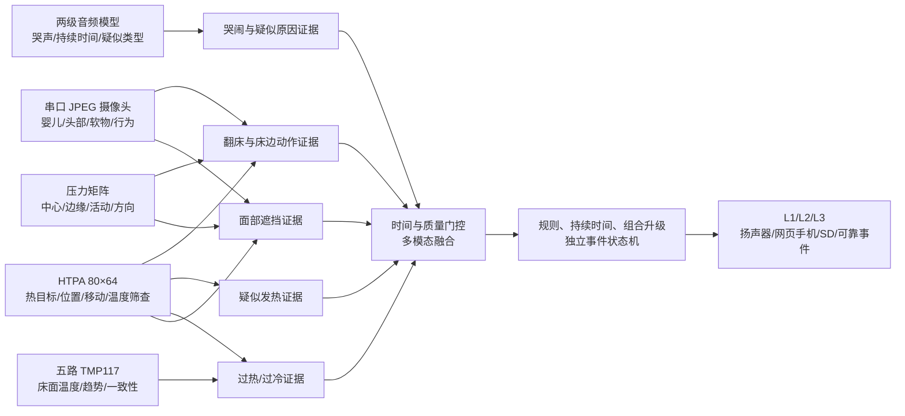
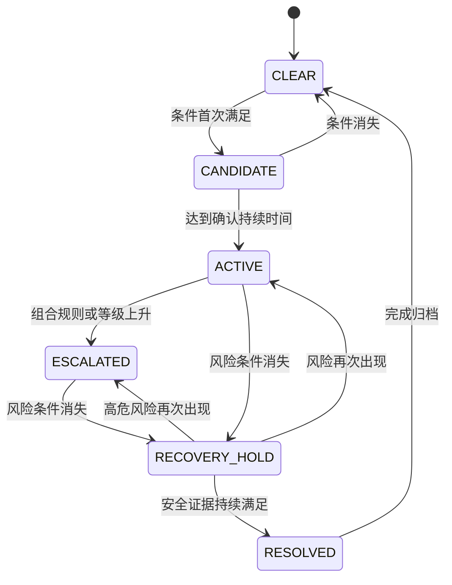
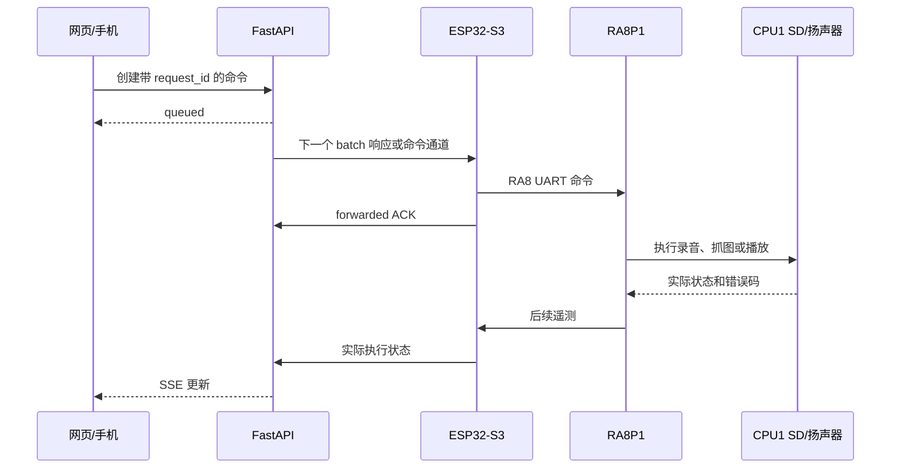
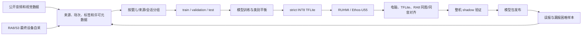

# RA8P1 多模态婴儿状态辅助监测系统最终设计与实现

> 文档性质：完成态设计基线。
> 本文统一按系统已经完成并通过集成的口径描述，后续代码、硬件、网页和测试均以本文为实现与验收依据。

## 1. 项目摘要

本项目完成了一套以 EK-RA8P1 为边缘计算与实时控制核心的多模态婴儿状态辅助监测系统。系统同时接入麦克风、16×16 压力矩阵、HTPA 80×64 热阵列、五路 TMP117 床面温度、SCI3 串口 JPEG 摄像头、SD 卡、扬声器和 ESP32-S3 网关。

RA8P1 在本地完成传感器采集、音频与视觉推理、多模态证据融合、分级告警决策和本地告警。ESP32-S3 负责 RA8 到服务器的网络网关，同时通过独立低延迟通道提供实时音视频预览。FastAPI 服务器完成设备管理、实时状态、告警事件、远程命令、实验采集、标签、模型包和网页/手机端服务。

系统采用：

```text
感知层
→ 单模态特征与模型层
→ 统一证据层
→ 多模态融合层
→ 独立决策层
→ 本地执行与可靠通知层
```

系统没有使用一个总模型直接输出“安全/危险”，也没有让任何单个模型直接触发最终告警。所有风险均经过数据有效性检查、时间去抖、多源融合和独立决策。

本设计的范围已经锁定：RA8 视觉输入使用现有 SCI3 串口 JPEG 摄像头；ESP32-S3 固件在独立工程维护；项目不包含拍一拍、摇篮或其他机械安抚机构。从当前工程基线到本文完成态，新增实施范围仅为三视觉模型、融合层、决策层、多级告警和配套数据协议，其余软硬件链路沿用已经完成的系统基础。

## 2. 系统定位与安全边界

系统用于：

- 判断婴儿是否在床；
- 辅助区分睡眠、清醒和过渡状态；
- 检测普通哭声及实验性的哭声声学类型；
- 识别靠边、扒边、离床和明显活动；
- 识别口鼻清楚、部分遮挡、明显遮盖和面部不可见；
- 使用热阵列进行体表温度异常筛查；
- 使用五点床面温度与热阵列判断过热、过冷趋势；
- 监测热目标位置和压力分布；
- 识别传感器、摄像头、SD、网关和服务器链路故障；
- 生成 Level 1～Level 3 多级告警；
- 在本地锁存高等级告警并向服务器可靠上传事件；
- 采集带标签的音频、图像和多传感器参考数据。

系统不用于：

- 测量呼吸、血氧、心率或其他生命体征；
- 判断婴儿是否缺氧或停止呼吸；
- 诊断哭声的医学原因；
- 替代监护人、医疗设备或合规睡眠环境。

所有对外说明统一使用“状态与安全风险辅助提醒”，不使用“医疗监护”“呼吸监测”或“疾病诊断”等表述。

本文所称“红外摄像头”均指系统现有的 HTPA 80×64 热阵列；它提供热目标、位置、移动和体表温度筛查证据，不等同于高分辨率红外 RGB 摄像头。

## 3. 最终完成的主要功能

| 模块 | 完成能力 |
| --- | --- |
| RA8 双核固件 | CPU0/CPU1 FreeRTOS、跨核共享内存、数据一致性和模块健康管理 |
| 麦克风 | 16 kHz 单声道采集、实时推理、SD WAV 录音和自定义文件名 |
| 哭声检测 | 1 秒 MFCC、250 ms 滑窗、短哭声防抖、多窗口确认和释放保持 |
| 哭声类型 | hungry、belly_pain、discomfort、tired、burping 五类及 unknown 拒识 |
| 压力矩阵 | 16×16 原始矩阵、占用、压力中心、边缘载荷、活动量和移动方向 |
| 热阵列 | HTPA 80×64 完整帧、CRC、热目标、位置、面积、活动及体表温度异常筛查 |
| 床面温度 | 五路 TMP117 温度、范围、趋势和一致性诊断 |
| 视觉推理 | YOLOX-Tiny 场景检测、MobileNetV3 遮盖分类和行为分类 |
| 视觉输入 | SCI3 38400 波特率串口 JPEG、完整帧校验、解码、缩放和外部内存缓冲 |
| TTL 摄像头 | SCI3 JPEG 抓图、分块 IPC、SD `.TMP` 完整写入后改名 `.JPG` |
| 多模态融合 | 多标签上下文、质量门控、时间对齐、冲突识别和置信度融合 |
| 告警决策 | 并行规则、独立事件状态机、组合升级、恢复保持和人工确认 |
| 安全输出 | Level 3 告警锁存、扬声器提示、可靠通知和事件证据保存 |
| ESP32-S3 | 独立固件工程完成 RA8 网关、命令转发、事件 ACK、断网重连和实时音视频 WSS |
| 服务端 | FastAPI、SQLite、遥测、矩阵、事件、命令、采集、模型和移动 API |
| 网页 | 总览、实时媒体、录制测试、传感器、告警、日志、数据集和模型页面 |
| 训练系统 | 音频与视觉数据整理、分组划分、训练、INT8、RUHMI 和部署验证 |

## 4. 最终系统总体架构



架构中存在两条相互独立的图像/媒体用途：

1. RA8 的 SCI3 串口 JPEG 摄像头同时负责本地视觉模型、抓图测试和 SD 数据采集；
2. ESP32-S3 摄像头和麦克风负责远程实时预览。

ESP32-S3 固件维护在独立工程中，通过本文和 `server/MEDIA_STREAM_PROTOCOL.md` 规定的协议与本仓库集成。实时预览不参与本地安全闭环，网络中断不会停止 RA8 的视觉、融合和告警。

## 5. 双核任务分配

### 5.1 CPU0 / Cortex-M85

CPU0 负责计算密集和安全决策任务：

- 麦克风底层采集；
- MFCC 特征提取；
- 一级哭声检测；
- 二级哭声类型分类；
- SCI3 JPEG 冻结、长度读取、分块接收、SOI/EOI 校验和恢复；
- JPEG 解码、颜色转换、缩放和 letterbox；
- YOLOX-Tiny 场景检测；
- MobileNetV3-Small 遮盖分类；
- MobileNetV3-Small 行为分类；
- Ethos-U55 串行调度；
- 统一证据快照；
- 多模态融合；
- 告警规则和事件生命周期；
- 告警状态锁存和本地提示；
- RA8-ESP32 UART、CRC、遥测和可靠事件。

### 5.2 CPU1 / Cortex-M33

CPU1 负责稳定的底层采集和文件系统任务：

- HTPA 80×64 UART 收帧、CRC 和异常恢复；
- M1616 压力分包接收和 16×16 矩阵重组；
- 五路 TMP117 扫描；
- SDHI/FAT 初始化、重试和状态诊断；
- 麦克风 WAV 写入；
- TTL 摄像头 JPEG 写入；
- 系统日志；
- 扬声器 WAV 播放；
- 向 CPU0 发布带序号、时间戳和质量状态的快照。

CPU1 不执行最终告警决策。所有跨传感器安全判断集中在 CPU0，避免两个核心产生不一致结论。

## 6. 跨核共享内存

| 地址 | 数据 |
| --- | --- |
| `0x221CFF00` | 摄像头诊断兼容区 |
| `0x221D0000` | HTPA 热阵列摘要 |
| `0x221D0100` | TMP117 摘要 |
| `0x221D0200` | 5120 点热阵列 |
| `0x221D2A00` | TTL 摄像头命令、JPEG 分块和写入状态 |
| `0x221D3000` | 扬声器命令和播放状态 |
| `0x221D3400` | 16×16 压力矩阵 |
| `0x221D3800` | 麦克风 PCM、录音命令和写入状态 |
| `0x221D3F00` | SD 初始化和恢复状态 |

共享邮箱统一采用：

```text
写入载荷
→ 内存屏障
→ 最后更新 sequence
```

读取矩阵时，CPU0 在复制前后检查 sequence。若 sequence 变化，则丢弃本次副本并重新读取，避免跨核读到半帧数据。

## 7. 系统完整数据流



## 8. 音频 AI 子系统

### 8.1 统一音频输入

系统使用：

```text
16 kHz
16 bit PCM
单声道
1 秒窗口
250 ms 步长
49×10×1 MFCC
INT8
```

音频预处理包括：

- 24 bit 原始采样转换；
- 直流分量抑制；
- 增益和限幅；
- 高通与低通；
- 分块 RMS 归一化；
- Hann 窗；
- 512 点 FFT；
- 40 个 Mel 频带；
- 前 10 个 MFCC；
- 与训练一致的均值和标准差；
- INT8 量化。

### 8.2 一级哭声检测

一级模型输出：

```text
non_cry
cry
```

系统没有要求哭声连续不断。每个 1 秒窗口得到一次概率，最近 8 个窗口中至少 3 个达到 `0.50` 即确认哭声。确认后，每次新命中都把释放保持恢复为 12 个窗口，约 3 秒。

因此短促哭声、哭声换气和中间停顿不会让状态立即归零。

### 8.3 二级哭声类型

二级模型只在一级哭声窗口命中时运行，输出：

```text
hungry
belly_pain
discomfort
tired
burping
```

系统滚动平均最多 8 个有效哭声窗口，从第 3 个窗口开始允许给出结果。当最高平均概率低于 `0.55`，或第一名与第二名差值低于 `0.10` 时，输出：

```text
unknown
```

网页中文映射为：

| 模型类别 | 页面说明 |
| --- | --- |
| `hungry` | 疑似饥饿 |
| `belly_pain` | 疑似腹痛/胀气 |
| `discomfort` | 疑似一般不适，可能包含尿布或排泄相关不适，需人工确认 |
| `tired` | 疑似疲倦 |
| `burping` | 疑似需要拍嗝/胀气 |
| `unknown` | 原因未知或证据不足 |

二级结果只显示在网页和事件上下文中，不参与遮盖、离床、温度或告警等级决策。

## 9. 视觉 AI 子系统

### 9.1 场景检测模型

| 项目 | 规格 |
| --- | --- |
| 模型 | YOLOX-Tiny INT8 |
| 输入 | 224×224 |
| 类别 | infant、head_face、blanket、soft_object、caregiver |
| 运行方式 | 每收到一张完整、有效的串口 JPEG 后运行一次 |
| 作用 | 婴儿、头部、被子、软物体和照护者定位 |

床沿不由模型识别。摄像头安装完成后，系统保存固定坐标：

```text
中心安全区
边缘预警区
床外区域
```

### 9.2 口鼻遮盖模型

| 项目 | 规格 |
| --- | --- |
| 模型 | MobileNetV3-Small minimalistic INT8 |
| 输入 | 192×192 头部 ROI |
| 类别 | clear、partial、covered、not_visible |
| 运行方式 | 当前 JPEG 检测到头部时运行一次 |

四类语义严格区分：

- `clear`：口鼻区域可见；
- `partial`：存在部分遮挡；
- `covered`：被子、手或软物明显覆盖主要区域；
- `not_visible`：转头、俯卧、过暗、模糊或头部不可可靠判断。

`not_visible` 不等于 `covered`。视觉系统只输出遮挡风险，不输出呼吸结论。

### 9.3 行为状态模型

| 项目 | 规格 |
| --- | --- |
| 模型 | MobileNetV3-Small minimalistic INT8 |
| 输入 | 192×192 婴儿 ROI |
| 类别 | lying、sitting、crawling_kneeling、standing、unknown |
| 运行方式 | 当前 JPEG 检测到婴儿时运行一次 |

单帧 `lying` 不直接等于睡眠，单帧 `standing` 也不直接等于床边危险。睡眠、清醒和床边风险由融合层结合时间窗口、位置、压力与热成像判断。

### 9.4 串口 JPEG 输入链

摄像头连接和格式固定为：

```text
摄像头 TX → RA8 P905 / RXD3
摄像头 RX → RA8 P310 / TXD3
SCI3 38400 / 8N1
JPEG
```

每一帧按照以下流程处理：

```text
STOP_FRAME
→ GET_SIZE
→ READ_CHUNK
→ 校验接收长度
→ 校验 JPEG SOI/EOI
→ 保存完整 JPEG 到外部缓冲
→ 发布给 CPU1 写入 SD
→ JPEG 解码和模型预处理
→ 三模型推理
→ RESUME_FRAME
```

任何阶段失败都会记录 `capture_stage`、实际接收长度和响应头，并丢弃当前帧。未完成或缺少 SOI/EOI 的数据不会进入模型，也不会保存成 `.JPG`。

38400 波特率决定了视觉是低帧率、事件驱动链路。系统不假设固定 2～4 FPS，而是持续统计：

```text
JPEG 字节数
完整抓图耗时
解码耗时
推理耗时
相邻有效帧间隔
```

视觉证据的新鲜度根据最近有效帧间隔动态判断。压力矩阵、热阵列和音频承担连续活动与位置变化检测；串口视觉负责目标、头部、被子、遮盖和姿态确认。

### 9.5 NPU 调度

三个视觉模型在 Ethos-U55 上串行运行：

```text
收到完整 JPEG 并完成解码
→ 场景检测
→ 有 head_face 时运行遮盖分类
→ 有 infant 时运行行为分类
→ 发布同一视觉周期的证据快照
```

系统复用模型工作区，不同时长期保留三个最大 tensor arena。外部 SDRAM/OSPI 用于图像缓冲、模型常量和中间工作区；音频采集、融合和安全线程不被视觉推理阻塞。

行为模型的 `active` 和帧间视觉位移只作为低频辅助证据。快速活动量、持续移动和靠边趋势以压力矩阵与热阵列时间序列为主。

## 10. 非模型传感器特征

### 10.1 压力矩阵

系统从 16×16 原始矩阵计算：

- 空床基线；
- 总载荷；
- 占用与释放迟滞；
- 压力中心 `center_x/center_y`；
- 外侧约 15% 区域载荷比例；
- 帧间变化量；
- 活动强度；
- 身体移动方向。

空床基线带版本和 CRC，仅在 RGB、压力和热阵列共同确认空床时校准或缓慢更新，不会在婴儿已经在床时自动重建。

### 10.2 HTPA 80×64 热阵列

系统计算：

- 热目标是否存在；
- 热目标中心；
- 热目标面积；
- 热目标移动；
- 夜间人体位置冗余；
- 温度范围和异常点；
- 经安装距离、环境温度和有效 ROI 校准的体表温度筛查值；
- 帧完整性和 CRC 状态。

热阵列不用于判断鼻子、嘴或呼吸，也不能单独诊断“发烧”。网页统一显示“疑似发热/体表温度异常”，需要监护人使用合规体温计复核。

### 10.3 TMP117

系统计算：

- 五路床面温度；
- 有效传感器位图；
- 最小、最大和平均温度；
- 温度变化速度；
- 传感器之间的一致性；
- 警告和紧急温度条件。

温度阈值作为版本化工程配置，由床面材料、传感器安装和实测数据校准，不解释为婴儿体温。

## 11. 统一证据层

每条证据统一包含：

```text
source
sequence
capture_tick
publish_tick
age_ms
valid
quality
fault_code
value/probabilities
geometry
```

### 11.1 视觉证据

```text
infant_present + infant_bbox
head_present + head_bbox
blanket_boxes[]
soft_object_boxes[]
caregiver_present
occlusion_prob[4]
behavior_prob[5]
infant_to_edge_distance
head_object_overlap
body_motion_vector
frame_quality
camera/model/preprocess health
```

### 11.2 压力证据

```text
occupied
total_load
center_x / center_y
edge_ratio
activity
movement_vector
baseline_valid
```

### 11.3 热阵列证据

```text
target_present
target_center
target_area
activity
min/max/average temperature
body_surface_screening_temperature
temperature_measurement_quality
frame_quality
```

### 11.4 音频证据

```text
raw_cry_probability
cry_confirmed
vote_hits
release_hold
cry_duration
experimental_type
type_confidence
type_valid
```

摄像头、压力和热阵列坐标全部转换为 0～1 归一化床面坐标。安装标定文件保存传感器旋转、镜像、床边 ROI 和有效区域。

## 12. 多模态融合层

融合层不产生告警，只形成并行上下文和风险证据：

```text
presence:       PRESENT / ABSENT / UNCERTAIN
arousal:        SLEEPING / AWAKE / TRANSITION / UNKNOWN
bed_motion:     QUIET / ROLLING / ACTIVE / UNKNOWN
airway_view:    CLEAR / PARTIAL / COVERED / NOT_VISIBLE / UNKNOWN
edge_state:     CENTER / NEAR_EDGE / EDGE_GRAB / OUTSIDE / UNKNOWN
distress:       NONE / CRYING / PERSISTENT_CRY / UNKNOWN
cry_cause_hint: HUNGRY / BELLY_PAIN / DISCOMFORT / TIRED / BURPING / UNKNOWN
body_temp:      NORMAL / SUSPECTED_FEVER / UNKNOWN
bed_thermal:    NORMAL / OVERHEAT / UNDERHEAT / UNKNOWN
caregiver:      PRESENT / ABSENT / UNKNOWN
system_health:  OK / DEGRADED / BLIND
```

这些状态可以同时成立，例如：

```text
presence=PRESENT
arousal=SLEEPING
airway_view=NOT_VISIBLE
edge_state=CENTER
distress=NONE
system_health=DEGRADED
```

### 12.1 数据质量门控

每项证据的有效权重由以下因素共同决定：

```text
effective_evidence =
  model_or_feature_confidence
  × source_quality
  × freshness_factor
```

但高危规则不使用一个总分替代显式条件。融合置信度用于展示和排序，告警是否成立仍由决策规则确定。

### 12.2 婴儿存在

```text
压力存在 +（RGB infant 或 HTPA 热目标）
→ PRESENT

只有一个健康来源判断存在，或来源持续冲突
→ UNCERTAIN

RGB、压力和热阵列在各自健康前提下连续约 5 秒都不存在
→ ABSENT
```

### 12.3 睡眠与清醒

```text
AWAKE:
  active 持续约 3 秒
  或压力活动明显
  或哭声确认

SLEEPING:
  presence=PRESENT
  且 quiet 持续约 45 秒
  且压力变化低
  且最近约 10 秒无哭声

其他:
  TRANSITION
```

清醒快速确认，睡眠缓慢确认。`SLEEPING` 是上下文，不降低任何风险告警等级。

### 12.4 照护者上下文

照护者存在用于解释：

- 抱离床；
- 调整被褥；
- 短时大幅压力变化；
- 手臂遮挡画面。

照护者存在不会抑制明确的 `covered` Level 3，也不会自动解除已经锁存的紧急事件。

## 13. 决策层与告警等级

融合层回答“现在可能是什么状态”，决策层回答“是否需要告警、告警到什么程度、执行什么动作”。

### 13.1 App 等级与协议 severity

| App 状态 | severity | 定义 | 默认动作 |
| --- | ---: | --- | --- |
| `normal` / `sleeping` | 0 | 无告警，睡眠仅为上下文 | 常规显示和记录 |
| `level1` | 1 | 观察：短时异常、弱证据或传感器冲突 | 页面提示和日志 |
| `level2` | 2～3 | 警告：持续可疑状态或监测能力明显下降 | 网页/手机通知、可选扬声器提示、事件记录 |
| `level3` | 4～5 | 紧急：高可信危险或危险组合 | 告警锁存、扬声器提示、可靠上传和人工处理 |

系统同时维护多个活动事件。全局等级取最高值，但页面显示所有事件，不能只保留一个主状态。

### 13.2 五类核心业务告警

| 业务告警 | 主要证据 | 辅助证据 | 决策层输出 |
| --- | --- | --- | --- |
| 翻床/异常床边动作 | 压力中心、边缘载荷、活动量和向外移动趋势 | 串口摄像头的 infant/edge ROI 与 `standing` 姿态，HTPA 热目标位置与移动 | 普通翻身只记录；持续靠边为 L2；站立且边缘压力持续向外、翻越趋势或离床为 L3 |
| 哭闹 | 一级哭声模型的确认、占空比和持续时间 | 二级声学类别及其他风险上下文 | 普通哭声为 L1 上下文；持续哭闹为 L2；原因只作提示 |
| 发烧（疑似发热筛查） | HTPA 有效人体 ROI 的校准体表温度筛查值 | 婴儿存在、环境温度、帧质量和连续时间 | 持续异常为 L2，提示使用体温计复核；不输出医学诊断 |
| 过热/过冷 | 五路 TMP117 的中位数、极值、趋势和一致性 | HTPA 整体热分布、婴儿存在 | 持续越界为 L2，极端且婴儿在床时可升 L3 |
| 面部遮挡 | RGB 头部 ROI 的 clear/partial/covered 与软物重叠 | HTPA 头部热目标位置、压力姿态变化 | `not_visible/partial` 为 L2；连续确认 `covered` 为 L3 |

本文将“翻床”定义为床上明显翻动及其向床边发展的风险过程。中心安全区内的正常翻身只更新 `bed_motion=ROLLING` 并记录；只有持续靠边、扒边/翻越趋势或离床证据成立时才升级告警。

哭声二级模型输出的 `hungry`、`belly_pain`、`discomfort`、`tired`、`burping` 和 `unknown` 都是“疑似声学类别”。其中 `discomfort` 可在界面解释为“一般不适，可能包含尿布或排泄相关不适”，但没有对应标注数据时不能直接显示“已拉屎/已排尿”。哭声原因不单独决定告警等级。

除上述五类业务告警外，系统还保留离床、监测盲区、传感器失效、摄像头冻结和网关离线等系统/派生告警，避免模型或链路失效时静默。



## 14. 完整告警规则

| 规则 ID | 确认条件 | 等级 | 恢复条件 | 系统动作 |
| --- | --- | ---: | --- | --- |
| `presence.conflict` | 健康来源对存在状态冲突约 5 秒 | L1 | 连续约 10 秒一致 | 显示冲突来源，禁止强判离床 |
| `monitor.sensor_degraded` | 一个关键传感器或模型 stale/故障 | L1 | 连续多个新鲜有效帧 | 记录故障，不覆盖其他风险 |
| `monitor.blind` | 两个以上关键存在来源不可用约 10 秒 | L2 | 核心来源稳定恢复 | 人工检查并明确显示监测盲区 |
| `airway.face_not_visible` | infant/head 存在且连续两张有效 JPEG 为 `not_visible` | L2 | 连续两张有效 JPEG 为 clear | 提示检查姿态 |
| `airway.partial` | 连续两张有效 JPEG 为 partial 或头部与软物部分重叠 | L2 | 连续两张有效 JPEG 为 clear | 提示、保存事件图 |
| `airway.covered` | covered 高且头部与被子/软物明显重叠；单帧先警告，连续两张有效 JPEG 确认 | L2 → L3 / sev 5 | 连续两张 clear、恢复保持及人工处理 | 告警锁存、扬声器提示、可靠通知 |
| `edge.near` | 压力中心在外侧区约 2 秒，且最近一张新鲜 JPEG 中 infant 框进入边缘 ROI | L2 | 压力与视觉都回到安全区 | 靠边提醒、保存压力/图像 |
| `edge.climbing` | `edge.near` 加一张高可信 `standing`，并有压力持续向外移动 | L3 / sev 4～5 | 返回安全区并完成人工处理 | 告警锁存和可靠通知 |
| `presence.out_of_bed` | 曾在床，压力释放并有跨边轨迹或多源离床证据 | L3 / sev 4 | 返回床内或人工确认安全 | 可靠通知和证据保存 |
| `distress.cry` | 一级模型通过 3/8 投票 | L1 | 12 窗释放保持结束 | 显示哭声上下文 |
| `distress.persistent_cry` | 哭声长时间持续或高占空比 | L2 / sev 2～3 | 长时间无哭声 | 通知并与其他风险组合 |
| `body_temp.suspected_fever` | HTPA 人体 ROI 质量有效，校准筛查值持续越过工程阈值，且 presence=PRESENT | L2 / sev 3 | 回到退出阈值并稳定，或人工复核 | 显示“疑似发热”，提示体温计复核 |
| `environment.overheat` | 五路 TMP117 多数一致偏高，且 HTPA 整体热趋势支持 | L2；极端时 L3 / sev 4 | 回到退出阈值并稳定 | 显示床面温度、趋势和来源 |
| `environment.underheat` | 五路 TMP117 多数一致偏低，且 HTPA 整体热趋势支持 | L2；极端时 L3 / sev 4 | 回到退出阈值并稳定 | 显示床面温度、趋势和来源 |
| `camera.frozen` | 连续抓图开启时，超过最近有效帧周期的 3 倍仍无新 sequence，或重复帧/严重失焦 | L1，长期 L2 | 连续两张新鲜有效 JPEG | 清除旧视觉证据，提示检查 |
| `gateway.offline` | 服务器连续收不到网关遥测 | L2 运维 | 遥测恢复 | 远程告警，本地安全链继续 |

### 14.1 组合升级规则

```text
near_edge + 新鲜 standing 帧 + 压力持续向外移动
→ Level 3

温度 warning + persistent_cry
→ 至少 Level 2，并提高通知优先级

partial/not_visible + persistent_cry
→ Level 2，提示尽快检查

明确高危视觉证据 + 冗余传感器故障
→ 高危事件仍然成立，同时增加 health_degraded

caregiver_present + covered
→ 仍为 Level 3
```

模型概率不会简单相乘后直接决定告警。每个组合都有明确、可回放和可测试的规则 ID。

## 15. 并行事件状态机

每条规则拥有独立状态机：



事件属性分别记录：

```text
opened
active
escalated
acknowledged
recovery_hold
resolved
```

`acknowledged` 表示用户已经看到事件，`resolved` 表示风险证据已经恢复安全。人工确认不会直接清除风险。

## 16. 全局主状态与兼容输出

系统内部输出：

```text
context_state
active_incidents[]
primary_incident
global_alarm_level
health_state
```

同时保留原 RA8 `safe.state 0..11` 兼容字段：

| state | 兼容名称 |
| ---: | --- |
| 0 | normal |
| 1 | near_edge |
| 2 | out_of_bed |
| 3 | overheat |
| 4 | underheat |
| 5 | sensor_fault |
| 6 | crying |
| 7 | face_covered |
| 8 | standing |
| 9 | moving |
| 10 | sleeping |
| 11 | awake |
| 255 | test_alarm |

`safe.state` 只表示供旧协议和旧页面使用的主状态；新网页和手机端以 `active_incidents[]` 为准。

主事件按以下顺序选择：

1. severity 更高；
2. 同 severity 时，直接实体风险优先；
3. 再按首次发生时间；
4. 传感器故障作为并行 health 事件，不覆盖已确认的遮盖、扒边或离床风险。

## 17. Level 3 本地告警动作

进入 Level 3 后，RA8 本地立即：

- 锁存 Level 3 告警状态；
- 停止普通音乐或提示音播放，切换到告警提示；
- 通过扬声器输出本地告警；
- 保存事件日志；
- 保存事件前后关键 JPEG、压力、热阵列和音频摘要；
- 生成可靠安全事件；
- 在事件恢复前持续向网页和手机报告活动状态。

Level 3 的退出条件为：

```text
风险证据连续恢复安全
+ 必要传感器状态有效
+ 达到恢复保持时间
+ 需要人工处理的事件已确认
→ resolve
```

项目不包含拍一拍、摇篮或其他机械安抚机构，因此决策层只管理告警、扬声器、记录和通知，不输出机械控制命令。

## 18. RA8 与 ESP32-S3 通信

### 18.1 物理和帧协议

RA8 与 ESP32-S3 使用：

```text
921600 波特率
8N1
CRC16
带类型、长度和 sequence 的二进制帧
```

主要消息包括：

- 状态遥测；
- 热阵列分块；
- 压力矩阵；
- 可靠安全事件；
- 事件 ACK；
- 网关命令；
- 命令响应和诊断。

### 18.2 可靠事件

RA8 为事件分配单调递增 ID，并使用有界优先队列保存未确认事件。Level 3 事件不会被低等级事件挤出。

ESP32-S3 收到事件后：

1. 校验 UART CRC；
2. 将事件加入本地投递队列；
3. 向 RA8 返回事件 ACK；
4. 通过独立 HTTPS 请求上传服务器；
5. 断网时保留并在恢复后重投；
6. 服务器按设备 ID 和事件 ID 去重。

RA8 ACK 与用户确认完全独立。

### 18.3 融合与告警协议扩展

系统沿用现有消息类型，不额外建立媒体式高频通道：

- `0x10 STATUS_UPLOAD` 携带当前融合快照、主告警和活动事件摘要；
- `0x13 SAFETY_EVENT` 携带事件 `open/update/escalate/resolve`；
- `0x22 SAFETY_ACK` 仍只确认 `event_id` 已进入 S3 本地可靠队列。

`0x10` 的新增语义字段使用 `schema_version=2`，旧字段 `safe.state/conf/severity/sources` 保留。S3 和服务器必须忽略未知字段，因此旧固件与旧页面可继续工作。服务器侧语义结构如下：

```json
{
  "schema_version": 2,
  "fusion": {
    "evidence_seq": 308,
    "presence": "present",
    "arousal": "awake",
    "bed_motion": "rolling",
    "airway_view": "clear",
    "edge_state": "center",
    "distress": "crying",
    "cry_cause_hint": "hungry",
    "cry_cause_confidence": 71,
    "body_temp": "normal",
    "bed_thermal": "normal",
    "caregiver": "absent",
    "system_health": "ok"
  },
  "alarm": {
    "global_level": 1,
    "primary_incident_id": "ra8-000042",
    "active_count": 1,
    "active_type_mask": 2
  }
}
```

RA8–S3 UART 中使用紧凑枚举、整数温度和位掩码表达同一语义，S3 转换为服务器 JSON；不在每个状态包中重复传输检测框、整张 JPEG 或完整证据数组。事件发生时，`0x13` 再携带规则 ID、证据摘要、模型/规则版本和来源健康。

核心事件类型固定为：

| 业务 | 事件类型 |
| --- | --- |
| 翻床/床边动作 | `bed.rollover`、`edge.near`、`edge.climbing`、`presence.out_of_bed` |
| 哭闹 | `distress.cry`、`distress.persistent_cry`、`distress.cause_hint` |
| 疑似发热 | `body_temp.suspected_fever` |
| 过热/过冷 | `environment.overheat`、`environment.underheat` |
| 面部遮挡 | `airway.face_not_visible`、`airway.partial`、`airway.covered` |
| 系统健康 | `monitor.sensor_degraded`、`monitor.blind`、`camera.frozen`、`gateway.offline` |

`bed.rollover` 和 `distress.cause_hint` 默认只作为 `0x10` 融合上下文或现有 incident 的 `update`，不因每次翻身或类别波动单独占用可靠事件队列。Level 2/3、事件首次打开、升级和最终恢复才必须通过 `0x13` 可靠发送。

## 19. ESP32-S3 实时音视频

实时媒体使用两条独立 WSS：

```text
设备视频上传:
/api/v1/media/device/video

设备音频上传:
/api/v1/media/device/audio

浏览器视频订阅:
/api/dashboard/media/{device_id}/video/ws

浏览器音频订阅:
/api/dashboard/media/{device_id}/audio/ws
```

### 19.1 视频

- JPEG 二进制帧；
- 每条 WebSocket message 是一帧；
- 服务端和订阅者队列只保留最新帧；
- 网络拥塞时丢弃旧帧；
- 视频预览不写数据库。

### 19.2 音频

- 16 kHz；
- 单声道；
- PCM16 little-endian；
- 320 samples、640 字节、20 ms 每帧；
- S3 队列最多 8 帧，满时丢最旧；
- 浏览器 AudioWorklet 目标缓冲 3～4 帧；
- 音频预览不写数据库。

### 19.3 订阅控制

服务器根据浏览器订阅者数量向 S3 发送带版本和序号的 `media.control`。无订阅者时停止媒体采集并清空队列，但保留 WSS 心跳和 RA8 遥测链。

媒体链路与安全事件、传感器遥测和命令链路相互独立。

## 20. 服务器和网页

### 20.1 服务端数据链

| 数据 | 传输 | 存储 | 前端 |
| --- | --- | --- | --- |
| 状态遥测 | HTTPS batch | SQLite 滚动保留 | SSE |
| 热阵列/压力 | batch 或二进制矩阵 | 有限历史和训练会话引用 | SSE + Canvas |
| 安全事件 | 可靠 HTTPS | incident 生命周期 | SSE、事件页、确认 |
| 实时音视频 | WSS | 仅内存有界队列 | WSS |
| WAV/JPEG 训练文件 | RA8 SD 后导入 | 采集会话与原文件 | 数据集页面 |
| 模型包 | HTTPS ZIP | 模型仓库、manifest 和 SHA-256 | 模型页面 |

### 20.2 网页页面

系统网页包含：

- 总览：安全状态、活动事件、哭声、设备健康和趋势；
- 实时音视频：S3 摄像头画面和麦克风监听；
- 录制测试：直接控制 RA8 保存自定义 WAV/JPEG；
- 传感器：全部原始参数、压力和热阵列；
- 告警事件：open、update、escalate、resolve 和人工确认；
- 日志：RA8、ESP32、服务器和链路诊断；
- 数据集：独立采集、标签、质量、来源和数据划分；
- 模型：模型包、版本、任务、量化和校验信息。

### 20.3 命令流程



`forwarded` 只表示 ESP32 已转发，最终成功以 RA8/CPU1 状态为准。

## 21. 告警事件格式

事件包含：

```json
{
  "event_id": 42,
  "incident_id": "ra8-000042",
  "event_type": "airway.covered",
  "lifecycle": "open",
  "state": 7,
  "severity": 5,
  "confidence": 91,
  "rule_id": "airway.covered",
  "rule_version": 2,
  "sources": ["camera", "thermal"],
  "first_seen_tick": 123456,
  "confirmed_tick": 124956,
  "evidence": {
    "covered": 0.91,
    "head_object_overlap": 0.42,
    "frame_age_ms": 180,
    "thermal_seq": 88,
    "head_heat_target_valid": true
  },
  "health": {
    "camera": "ok",
    "pressure": "ok",
    "thermal": "degraded"
  }
}
```

同一 incident 可以产生：

```text
open
update
escalate
resolve
```

服务器分别保存 `acknowledged_at` 和 `resolved_at`。

不同业务事件的 `evidence` 至少包含：

| 事件组 | 必需证据字段 |
| --- | --- |
| 翻床/床边 | `pressure_seq`、`center_x/y_0_1000`、`edge_ratio_0_1000`、`activity`、`movement_x/y`、`vision_seq`、`thermal_seq` |
| 哭闹 | `audio_seq`、`cry_probability_0_1000`、`vote_hits`、`vote_window`、`duration_ms`、`cause_hint`、`cause_confidence_0_1000` |
| 疑似发热 | `thermal_seq`、`screening_temp_mc`、`threshold_mc`、`measurement_quality`、`roi_point_count`、`presence` |
| 过热/过冷 | `tmp_seq`、`tmp_valid_mask`、`tmp_mc[5]`、`thermal_seq`、`thermal_roi_avg_mc`、`threshold_profile_version` |
| 面部遮挡 | `vision_seq`、`occlusion_prob_0_1000[4]`、`head_object_overlap_0_1000`、`frame_quality`、`thermal_seq`、`head_heat_target_valid` |

UART 和服务器协议中的温度统一使用有符号毫摄氏度整数，归一化坐标和概率统一使用 `0..1000` 整数，避免不同编译器的浮点表示差异。每个事件同时携带 `model_version`、`rule_version` 和相关来源的 sequence，保证 SD 证据、服务器事件与网页显示可以对齐。

## 22. 数据采集与训练闭环



### 22.1 音频数据

- 公开哭声用于学习通用特征；
- RA8 麦克风实录用于设备域适配；
- 安静、说话、电视、音乐、风扇和宿舍噪声用于一级负样本；
- 哭声类型只使用标签定义一致的公开数据和对应 RA8 回放；
- 同一原始录音、分卷和增强版本不会跨数据划分。

### 22.2 视觉数据

- CribHD 提供被子和软物体基础；
- SyRIP 提供真实/合成婴儿和头部基础；
- 最终串口摄像头自采补充照护者、床栏、被褥、弱光和设备域；只有实物支持红外成像时才加入红外场景；
- 玩偶用于安全模拟 `covered`、`standing` 和床边危险姿态；
- 不会为了采集危险样本主动遮盖真实婴儿口鼻；
- 同一视频或场次的相邻帧全部保留在同一 split。

### 22.3 模型发布门禁

每个模型包包含：

```text
model_id
version
target
input/output contract
class order
quantization scale/zero-point
preprocessing version
rule compatibility version
model SHA-256
metrics
```

服务器保存模型包、训练契约和 SHA-256，用于版本追溯。RA8 模型随 CPU0 固件编译并通过 RFP 烧录；本项目不要求运行时模型热更新或自动回滚。

## 23. 典型运行流程

### 23.1 正常监测

```text
传感器连续采集
→ 各来源健康
→ presence=PRESENT
→ 睡眠/清醒上下文稳定
→ 无活动 incident
→ 网页显示 normal 或 sleeping
```

### 23.2 检测到哭声

```text
最近 8 个窗口命中至少 3 个
→ distress=CRYING
→ 创建 Level 1 cry 事件或上下文
→ 二级模型累计有效窗口
→ 显示类型或 unknown
→ 持续哭声达到规则时升级 Level 2
```

### 23.3 口鼻遮盖

```text
检测 infant/head
→ 头部 ROI 输出 covered
→ 被子/软物与头部重叠
→ 单张高可信帧进入 Level 2
→ 连续两张有效 JPEG 确认
→ airway.covered Level 3
→ 本地告警锁存
→ 可靠上传
→ 连续两张 clear 后进入 RECOVERY_HOLD
→ 满足恢复条件后 resolve
```

### 23.4 靠边与扒边

```text
普通翻身或短时压力变化
→ bed.rollover 上下文/记录，不直接告警

压力中心进入外侧区
+ infant 框进入边缘 ROI
+ HTPA 热目标位置趋势支持
→ edge.near Level 2

最近有效 JPEG 出现 standing
+ 压力持续向外移动
→ edge.climbing Level 3
→ 立即告警锁存
```

### 23.5 疑似发热与过热/过冷

```text
HTPA 人体 ROI 有效
+ 校准体表温度筛查值连续异常
+ 婴儿存在证据成立
→ body_temp.suspected_fever Level 2
→ 提示使用合规体温计复核

五路 TMP117 多数一致越过床面阈值
+ HTPA 整体热趋势支持
→ environment.overheat / underheat Level 2
→ 极端且婴儿在床时升级 Level 3
```

### 23.6 传感器故障

```text
单来源 stale
→ health=DEGRADED
→ 保留其他健康来源的风险判断

多个关键来源不可用
→ health=BLIND
→ Level 2 运维告警
→ 明确显示监测盲区并通知检查
```

`sensor_fault` 不会覆盖已经确认的 `airway.covered`、`edge.climbing` 或 `out_of_bed`。

### 23.7 训练采集

```text
网页选择设备、通道、标签和备注
→ 独立开始 camera/audio/thermal/pressure/temperature
→ 音频和 JPEG 写入 RA8 SD
→ 矩阵按会话在服务器归档
→ 停止后关闭文件
→ 导入 SD 原文件
→ 逐样本复核标签、质量和 split
```

## 24. 系统可靠性

### 24.1 本地优先

- 网络不参与 Level 3 判定；
- 服务器离线时 RA8 继续推理、融合和本地告警；
- ESP32 重连后恢复事件投递；
- 媒体拥塞不会阻塞遥测和安全事件。

### 24.2 新鲜度和冻结检测

- 每个传感器、模型和媒体来源使用独立 stale 门限；
- sequence 不增长即使时间戳变化也视为冻结；
- 重复 JPEG、过暗、失焦和推理错误分别上报；
- 旧模型结果过期后立即从融合中移除。

### 24.3 SD 和文件完整性

- SD 初始化失败自动重试；
- 所有写入通过 CPU1 文件系统锁；
- WAV 停止时修正文件头；
- JPEG 先写 `.TMP`；
- 只有检测到 SOI/EOI 且长度完整才改名 `.JPG`；
- 异常临时文件删除，不伪装成有效样本。

### 24.4 事件可靠性

- RA8 有界优先事件队列；
- ESP32 ACK 幂等；
- 服务器去重；
- lifecycle 更新不产生重复 incident；
- 用户确认和风险恢复分离；
- `safety_test` 可验证 RA8、ESP32、服务器和网页完整链路。

## 25. 验收与测试

### 25.1 单模态模型

- 各类别 precision、recall、F1 和混淆矩阵；
- `covered`、`standing`、`infant/head` 的召回单独验收；
- 白天、弱光分别统计；只有串口摄像头实物支持红外成像时才增加红外场景统计；
- 浮点和 INT8 差异在门限内；
- PyTorch、TFLite 和 RA8 输出对齐；
- NPU 算子下放、峰值内存和端到端延迟通过。

### 25.2 融合和决策

- 使用完整多传感器时间线回放；
- 五类核心业务告警分别建立正常、边界、危险和恢复用例；
- 正常翻身不会被误报为扒边或离床；
- 哭声原因变化不会单独改变告警等级；
- HTPA 体表温度筛查与 TMP117 床面冷热事件不会混为同一规则；
- 多事件可以同时存在；
- `not_visible` 不会被误写为 `covered`；
- 单一传感器故障不会清除其他高危事件；
- 清醒进入快、睡眠确认慢；
- Level 3 恢复不会因单帧安全结果自动清除；
- 误报按每小时事件数统计；
- 漏报按完整事件统计，不只看逐帧准确率。

### 25.3 故障注入

- 摄像头拔线、冻结、重复帧、遮镜头、过暗和失焦；
- 压力、热阵列、TMP117 超时和 CRC 错误；
- 麦克风停止和模型过期；
- SD 未插入、写满和写错误；
- ESP32 重启、Wi-Fi 断开和服务器重启；
- 暂停事件 ACK 和重复发送；
- Level 3 期间断网；
- 多个事件快速连续触发。

### 25.4 长时间运行

- 单视觉模型连续运行；
- 三视觉模型串行运行；
- 音频和视觉并行；
- 实时媒体开启和关闭；
- 传感器、SD、网络和网页整机长时间运行；
- 检查内存、任务栈、NPU、UART、SD 和网络重连。

## 26. 代码与文档模块映射

| 功能 | 主要目录/文件 |
| --- | --- |
| CPU0 线程 | `Multicore_top_CPU0/src/` |
| CPU0 业务代码 | `Multicore_top_CPU0/src/thread_code/` |
| CPU1 线程 | `Multicore_top_CPU1/src/` |
| CPU1 驱动和文件系统 | `Multicore_top_CPU1/src/thread_code/` |
| 公共 IPC | `common/` |
| RA8-ESP32 协议 | `tools/ra8_esp32_protocol/ESP32_ADAPTER_PROTOCOL.md` |
| 经典 ESP32 网关参考固件 | `firmware/esp32cam/` |
| ESP32-S3 网关和媒体固件 | 独立固件工程；与本仓库按 `server/MEDIA_STREAM_PROTOCOL.md` 对接 |
| FastAPI 和网页 | `server/` |
| 音频训练 | `ml_training/` |
| 视觉训练 | `vision_training/` |
| 现状与实施路线 | `docs/PROJECT_OVERVIEW_AND_MULTI_LEVEL_ALARM_zh-CN.md` |
| 本完成态设计 | `docs/PROJECT_FINAL_COMPLETED_DESIGN_zh-CN.md` |

## 27. 实现不可偏离的原则

1. 不把三个视觉模型合并成单一总状态分类器。
2. 不把 `not_visible` 当作 `covered`。
3. 不用热阵列判断口鼻或呼吸。
4. 不用哭声类型直接提高安全告警等级。
5. 不让单个模型绕过融合和决策层直接触发最终告警。
6. 不让传感器故障覆盖其他健康来源确认的高危事件。
7. 不把睡眠、清醒和移动当作危险事件。
8. 不把用户 ACK 当作风险已经解除。
9. 不让网络或实时媒体成为本地安全闭环的依赖。
10. 不把 JPEG、PCM 或完整矩阵塞入常规遥测 JSON。
11. 不随机拆分同一视频、录音或婴儿来源的相邻样本。
12. 不以玩偶测试代替真实婴儿场景验证。
13. 不因单帧恢复或用户 ACK 自动清除 Level 3。
14. 不修改安全规则而不更新规则版本和回放测试。
15. 不发布缺少 manifest、量化契约和 SHA-256 的模型。
16. 不把 HTPA 体表温度筛查结果写成已经诊断“发烧”。
17. 不把没有独立训练标签的 `discomfort` 写成已经排便或排尿。

## 28. 项目最终流程总结

```text
CPU1 稳定采集压力、热阵列、床温并管理 SD
CPU0 采集音频和视觉并运行两级音频模型与三视觉模型
所有数据先经过健康、时间戳、质量和坐标统一
融合层输出多标签婴儿上下文和风险证据
决策层为每条规则维护独立事件状态机
全局等级由全部活动事件聚合
Level 3 在 RA8 本地立即告警并锁存
ESP32-S3 可靠上传遥测和事件，同时独立提供实时媒体
FastAPI 向网页和手机提供状态、告警、控制、采集和模型服务
训练数据按来源与场次管理，并持续回流困难样本
```

该架构保证了系统具备可解释、可回放、可扩展和故障安全的完整闭环，也为增加新的传感器、模型或交互终端保留了统一接口。
