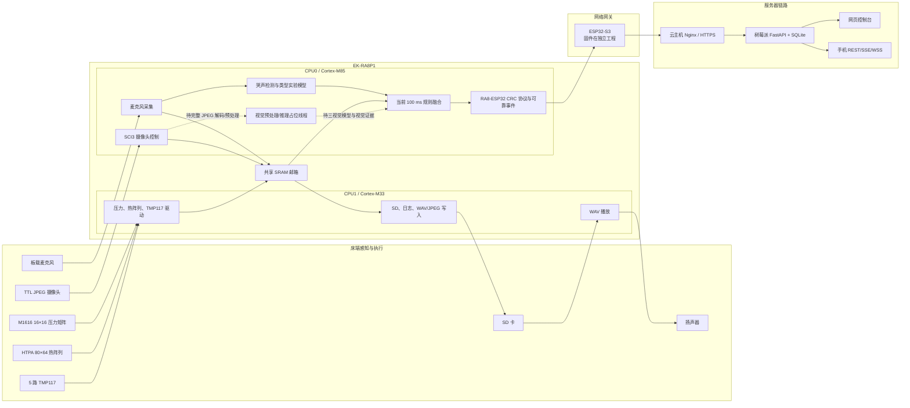
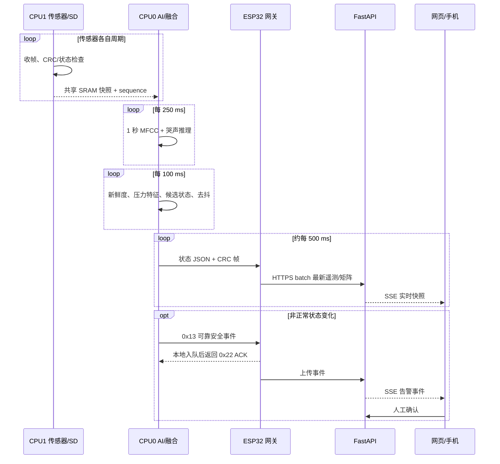
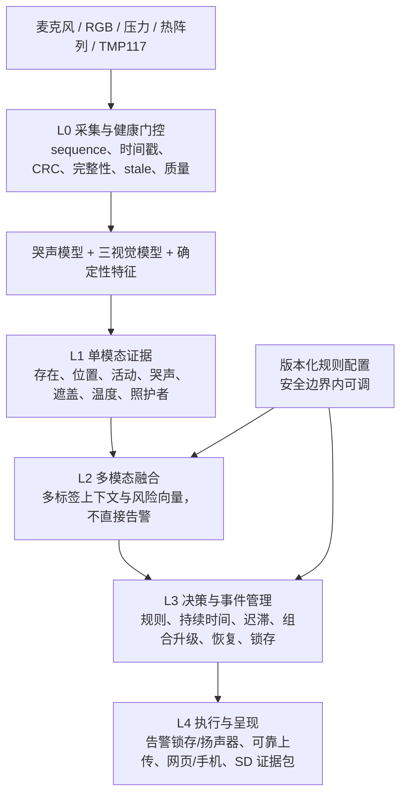
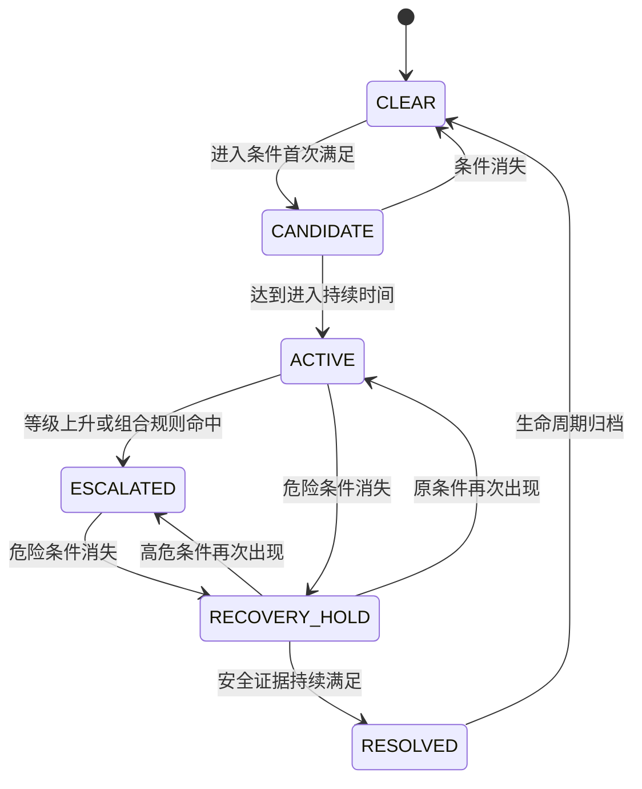
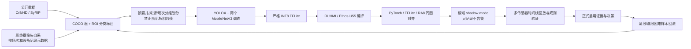

# RA8P1 婴儿状态辅助监测系统：项目概要、融合架构与多级告警设计

> 审阅基线：`agent/ra8-camera-training-workflow`，提交 `ef20d8f`，2026-07-26。  
> 本文面向课程设计、项目答辩和后续开发交接，严格区分“已经实现”“接口已预留”和“后续规划”。

## 1. 项目定位

本项目以 EK-RA8P1 为实时控制与边缘计算核心，组合麦克风、16×16 压力矩阵、HTPA 80×64 热阵列、TMP117 床面温度、摄像头、SD 卡和扬声器，经 ESP32 网关连接 FastAPI 服务器及网页/手机端。

系统目标不是让某一个模型直接输出“婴儿安全或危险”，而是：

1. 由每种传感器和单模态模型提供其擅长的、带时间戳的证据；
2. 由融合层形成可同时成立的状态，例如“在床、睡眠、靠边、面部不可见”；
3. 由独立决策层根据持续时间、证据组合、传感器健康和照护者上下文生成多级告警；
4. 在本地完成告警锁存、扬声器提示和证据保存，同时通过可靠事件链上传服务器；
5. 保存可追溯的实验数据，持续修正规则和模型。

系统只能表述为“婴儿状态与安全风险辅助提醒”。它不测量呼吸、血氧或生命体征，不判断缺氧，不诊断哭声的医学原因，也不能代替监护人和合规睡眠环境。

本文所称“红外摄像头”均指项目现有的 HTPA 80×64 热阵列；它提供热目标、位置、移动和体表温度筛查证据，不等同于高分辨率红外 RGB 摄像头。

## 2. 一句话概要

```text
多传感器采集
→ 单模态特征/模型
→ 时间对齐与质量门控
→ 多标签状态融合
→ 独立规则决策
→ 本地告警锁存与证据保存
→ ESP32 可靠上传
→ FastAPI 网页、手机端、数据集和模型管理
```

## 3. 当前完成度总览

### 3.1 已经实现并进入主工程

| 子系统 | 当前能力 | 主要位置 |
| --- | --- | --- |
| RA8 双核运行 | CPU0/CPU1 FreeRTOS 工程、共享 SRAM 邮箱、跨核序号一致性读取 | `Multicore_top_CPU0/`、`Multicore_top_CPU1/` |
| HTPA 80×64 | CPU1 UART 接收完整 5120 点帧、CRC、有效点和异常统计 | `thermal_uart_driver.c` |
| 16×16 压力矩阵 | CPU1 接收 M1616 分包并还原矩阵；CPU0 计算占用、压力中心和边缘载荷 | `pressure_matrix_driver.c`、`fusion_thread_entry.c` |
| TMP117 床面温度 | CPU1 扫描 5 个传感器并发布毫摄氏度数据 | `tmp117_matrix_driver.c` |
| RA8 麦克风 | 16 kHz 采集、自动启动、共享 PCM、SD WAV 录音 | `mic_capture_driver.c`、`mic_record_writer.c` |
| 哭声一级模型 | 1 秒 MFCC、250 ms 步长、INT8 MLP、3/8 窗口投票和释放保持 | `audio_cry_inference.c` |
| 哭声类型模型 | 五类实验分类、最多 8 个哭声窗口平均、低可信拒识为 `unknown` | `audio_cry_inference.c` |
| 扬声器 | CPU1 从 SD 卡读取 WAV 并播放 | `audio_wav_player.c` |
| SD 卡 | 启动延时、初始化恢复、文件系统锁、日志、WAV/JPEG 写入 | `sd_card_driver.c` |
| TTL 串口摄像头 | SCI3 探测、JPEG 分块读取、跨核传递、`.TMP` 完整写入后改名 `.JPG` | `serial_camera_driver.c`、`serial_camera_writer.c` |
| 第一版融合 | 每 100 ms 更新，检查新鲜度、计算候选状态、时间去抖并输出 `state 0..11` | `fusion_thread_entry.c` |
| 可靠安全事件 | RA8 事件重试、ESP32 本地入队后 ACK、服务器按设备事件 ID 去重 | `ra8_esp32_protocol.c`、`esp32cam.ino`、`server/app/main.py` |
| 网关与遥测 | ESP32 将 RA8 状态、压力和热阵列批量上传，接收并转发命令 | `firmware/esp32cam/` |
| ESP32-S3 媒体网关 | 独立固件工程已完成 RA8 网关、实时 JPEG/PCM WSS、命令转发和断网重连；本仓库维护服务端协议和网页接入 | 外部 S3 固件工程、`server/MEDIA_STREAM_PROTOCOL.md` |
| 服务端和网页 | FastAPI、SQLite、SSE、WSS、事件、命令、独立采集、标签、模型包、手机 API | `server/` |
| 训练数据工作流 | 音频清洗训练量化链和视觉三模型数据/训练/转换工具链 | `ml_training/`、`vision_training/` |

### 3.2 唯一尚未完成的工作

| 待完成项 | 已有基础 | 需要完成的闭环 |
| --- | --- | --- |
| 三视觉模型 | 串口摄像头已能抓取并保存完整 JPEG；视觉数据、训练、INT8 转换和部署脚本已具备 | 完整 JPEG 缓冲、解码/预处理、三个最终模型训练量化、RUHMI 编译、Ethos-U55 上板推理和实测验证 |
| 融合层 | 压力、热阵列、温度、音频和第一版互斥状态规则均已运行 | 统一证据结构、时间/质量门控、坐标映射、多标签上下文和多源冲突处理 |
| 决策与告警层 | 现有状态、可靠事件、扬声器、SD 证据和服务端事件基础均已运行 | 并行规则、事件生命周期、组合升级、恢复保持、Level 1～3 告警锁存及完整回放验证 |
| 配套数据协议与展示 | RA8–S3 CRC 协议、服务器遥测/事件接口及网页页面均已完成 | 新视觉证据、融合状态、活动事件、健康状态的版本化字段，以及 RA8–S3–服务器–网页端到端兼容升级 |

### 3.3 范围锁定

- 最终视觉输入就是现有 SCI3 38400 波特率串口 JPEG 摄像头，不再引入 MIPI 或第二路 RA8 摄像头。
- 视觉推理按“收到一张完整有效 JPEG 就处理一次”的事件驱动方式运行，不设固定 FPS 承诺。
- ESP32-S3 固件在独立工程维护，已视为完成；本仓库只维护与其一致的协议、服务器和网页。
- 项目不包含拍一拍、摇篮或其他机械安抚机构；Level 3 只执行告警锁存、扬声器提示、证据保存和可靠通知。
- 除三视觉模型、融合层、决策/告警层及其配套协议与展示外，其余系统均按已完成处理。
- 哭声类型仍只作为实验性声学提示，不得表述为医学原因。

## 4. 仓库结构与职责

```text
ra8p1/
├── Multicore_top_CPU0/     # Cortex-M85：麦克风、AI、融合、摄像头控制、ESP32 协议
├── Multicore_top_CPU1/     # Cortex-M33：传感器底层、SD、日志、媒体文件写入、扬声器
├── common/                 # 跨模块公共状态、IPC 和错误类型
├── firmware/esp32cam/      # 经典 ESP32 网关参考；正式 S3 固件在独立工程
├── server/                 # FastAPI、SQLite、网页、手机 API、部署配置
├── ml_training/            # 音频及早期多模态模型规格、训练、量化、验证
├── vision_training/        # 三视觉模型的公开数据、自采、训练、转换和部署基础
├── tools/                  # RA8-ESP32 协议模拟器、串口监视和诊断工具
└── data_collecter/         # 早期单核 FSP 骨架/参考工程，不是当前运行主工程
```

文档编写时应以双核 `Multicore_top_CPU0/CPU1` 为固件主线，不要从 `data_collecter` 的空线程推导当前系统结构。

## 5. 当前系统总体架构



## 6. 双核职责和共享数据

### 6.1 CPU0 / Cortex-M85

- 启动 CPU1。
- 采集麦克风并运行两级音频推理。
- 控制 TTL 摄像头抓取 JPEG。
- 读取 CPU1 发布的压力、热阵列、TMP117、SD 和文件写入状态。
- 每 100 ms 运行现有融合状态机。
- 通过 921600 波特率 UART 向 ESP32 发送状态、矩阵和可靠事件。
- 后续负责串口完整 JPEG 解码与预处理、三视觉模型、Ethos-U55 调度、证据融合和决策。

### 6.2 CPU1 / Cortex-M33

- HTPA 80×64 UART 收帧和 CRC 校验。
- M1616 16×16 压力矩阵接收。
- TMP117 床面温度扫描。
- SDHI/FAT 初始化、恢复和互斥访问。
- 系统日志、麦克风 WAV、摄像头 JPEG 写入。
- SD WAV 扬声器播放。
- 后续继续只发布带序号、时间戳和健康状态的底层快照，不负责最终安全决策。

### 6.3 共享 SRAM 邮箱

| 地址 | 内容 | 主要写入方 | 主要读取方 |
| --- | --- | --- | --- |
| `0x221CFF00` | 旧 USB 摄像头诊断 | CPU0 | CPU0/遥测 |
| `0x221D0000` | 热阵列摘要 | CPU1 | CPU0 |
| `0x221D0100` | TMP117 摘要 | CPU1 | CPU0 |
| `0x221D0200` | 5120 点热阵列 | CPU1 | CPU0/ESP32 |
| `0x221D2A00` | TTL 摄像头命令、分块和写入状态 | CPU0/CPU1 | 双方 |
| `0x221D3000` | 扬声器命令与状态 | CPU0/CPU1 | 双方 |
| `0x221D3400` | 16×16 压力矩阵 | CPU1 | CPU0 |
| `0x221D3800` | 麦克风 PCM、录音命令和写入状态 | CPU0/CPU1 | 双方 |
| `0x221D3F00` | SD 初始化与恢复诊断 | CPU1 | CPU0 |

发布顺序应保持为“先写载荷、内存屏障、最后更新序号”；矩阵读取方在复制前后校验序号一致。

## 7. 当前端到端运行流程



需要区分两种 ACK：

- ESP32 对 RA8 的 ACK：表示事件已进入网关本地投递队列，阻止 UART 无限重试；
- 用户对服务器事件的确认：表示“有人看到了”，不等于风险已经消失。

### 7.1 服务端的五类数据链

| 数据链 | 设备到服务器 | 保存方式 | 前端方式 | 设计目的 |
| --- | --- | --- | --- | --- |
| 状态遥测 | ESP32 约每 500 ms HTTPS batch | SQLite 有限滚动保留 | SSE | 设备状态、融合结果、健康诊断 |
| 压力/热阵列 | 最新矩阵随 batch 或二进制通道 | SQLite 有限历史；训练会话引用的不清理 | SSE + Canvas | 实时空间显示、规则分析和采集 |
| 安全事件 | RA8 可靠事件 → ESP32 队列 → HTTPS | 按 `device_id + source_event_id` 去重 | SSE、事件表、人工确认 | 不能由矩阵或媒体流替代 |
| 实时音视频 | ESP32-S3 独立 JPEG/PCM WSS | 只在内存保留最新/有界队列，不进数据库 | 浏览器/手机 WSS | 低延迟人工预览，不参与安全传输优先级 |
| 训练采集 | 矩阵在服务器按会话归档；WAV/JPEG 写 RA8 SD 后导入 | 会话、标签、质量、划分和原文件 | 数据集页面 | 保持样本和来源可追溯 |

命令采用相反方向：

```text
网页/手机
→ FastAPI commands 表排队
→ 下一个 batch 响应或低频 poll
→ ESP32 转为 RA8 UART 命令
→ RA8 实际状态随后续遥测返回
```

ESP32 的“命令已转发”只证明命令进入 RA8 链路。麦克风或摄像头文件是否真正创建，必须看 CPU1 的 SD 写入器状态、实际文件名和字节/帧计数。

### 7.2 网页、手机与部署

当前网页分为：

- 总览：安全状态、哭声、设备健康、趋势和矩阵；
- 实时音视频：ESP32-S3 JPEG/PCM 预览；
- 录制测试：直接控制 RA8 在 SD 保存自定义文件名 WAV/JPEG；
- 全部传感器：原始参数、命令和链路诊断；
- 告警事件与日志；
- 数据集：独立开始/停止各通道、标签、质量和 train/validation/test；
- 模型包：上传、校验、登记和下载；
- 手机 API：设备、快照、SSE、事件确认、命令和媒体 WSS。

公网部署链为：

```text
设备/用户
→ renesas.zyxserver.online 云主机 Nginx
→ Tailscale
→ 树莓派 FastAPI 容器与 SQLite
```

服务器也提供电脑热点/本地 Python 备用方式。部署凭据不属于架构文档，不能写入报告、Git 或日志。

## 8. 当前融合逻辑及其演进原因

当前 `fusion_thread_entry.c` 已完成一套可运行的第一版：

- 周期 100 ms；
- 开机宽限 10 秒；
- 传感器和模型 3 秒未更新视为 stale；
- 压力前 20 帧建立空床基线；
- 占用进入/释放阈值分别为 2000/1200；
- 外侧两圈压力占比达到 55% 判靠边候选；
- TMP117 最高达到 38°C 判过热、最低达到 10°C 判过冷；
- 哭声、睡眠、遮盖、站立、移动使用固定置信度门限；
- 一般危险进入去抖 1.5 秒，恢复正常 3 秒，传感器故障 5 秒；
- 输出一个互斥的 `state 0..11`。

这套逻辑适合早期打通系统，但后续视觉加入后有六个结构性限制：

1. **状态互斥**：婴儿可以同时“睡眠、靠边、脸部被遮盖”，单一状态会丢失信息。
2. **硬优先级遮蔽**：当前 `sensor_fault` 在最前面，可能掩盖仍由其他健康传感器确认的危险。
3. **融合与决策混在一起**：特征、阈值、持续时间、告警等级和主状态选择都在同一个函数中。
4. **来源不够严格**：例如当前遮盖和过热候选会声明 thermal 来源，但对应条件没有真正检查热阵列证据。
5. **事件缺少生命周期**：当前只在进入非正常主状态时生成事件，没有独立的 open/update/resolve，也只能保留一个主状态。
6. **上下文和告警未分开**：`moving/sleeping/awake` 也是非零状态，状态变化时可能生成 severity 0 的可靠事件；它们应作为上下文展示，而不是告警事件。

因此后续不应直接在现有 `if/else` 链继续追加条件，而应保留兼容输出，同时内部升级为“证据层—融合层—决策层—事件管理层”。

### 8.1 当前主状态字典

| state | 名称 | 当前典型 severity | 当前主要依据 |
| ---: | --- | ---: | --- |
| 0 | normal | 0 | 没有更高优先级候选 |
| 1 | near_edge | 4 | 压力外侧载荷占比 |
| 2 | out_of_bed | 4 | 曾占用后压力释放 |
| 3 | overheat | 4 | TMP117 最大值 |
| 4 | underheat | 3 | TMP117 最小值 |
| 5 | sensor_fault | 2 | 热阵列、TMP117、压力或麦克风 stale/异常 |
| 6 | crying | 3 | 新鲜哭声置信度 |
| 7 | face_covered | 5 | 预留视觉遮盖置信度 |
| 8 | standing | 4 | 预留视觉站立置信度 |
| 9 | moving | 0 | 预留视觉活动置信度 |
| 10 | sleeping | 0 | 预留视觉睡眠置信度 |
| 11 | awake | 0 | 压力占用或视觉上下文 |

该表描述当前代码，不代表目标告警等级。目标版本会把 `sleeping/awake/moving` 移到上下文向量，把 `near_edge` 拆成普通靠边警告和扒边紧急事件。

## 9. 目标五层架构



### 9.1 L0：采集与健康门控

每一项数据先回答“能不能用”，再回答“说明了什么”。至少保存：

```text
source
sequence
capture_tick
publish_tick
age_ms
valid
quality 0..100
fault_code
```

建议使用传感器独立 stale 门限，不再全部固定为 3 秒：

| 来源 | 初始工程门限 | 说明 |
| --- | ---: | --- |
| 压力矩阵 | 500～1000 ms | 原始链路频率较高，靠边判断需要较低延迟 |
| 视觉推理结果 | 最近实测完整抓图周期的约 3 倍 | 串口 JPEG 为事件驱动；还要检测重复帧、坏帧和 sequence 停滞 |
| 热阵列 | 2000～3000 ms | 按当前请求帧周期调整 |
| TMP117 | 3000 ms | 当前约 1 Hz |
| 音频模型 | 1000 ms | 当前每 250 ms 推理 |
| RA8-ESP32 遥测 | 连续 3 个周期或约 2～3 秒 | 只影响远程可见性，不应停止本地决策 |

这里的数值是工程初值，必须按实测帧率和最坏延迟校准。

### 9.2 L1：单模态证据

| 来源 | 建议输出的证据 | 不应承担的职责 |
| --- | --- | --- |
| 压力矩阵 | 是否占用、总载荷、压力中心、外侧占比、活动量、移动方向 | 单独判断面部遮盖 |
| HTPA 热阵列 | 热目标存在、目标中心、目标面积、活动量、夜间位置冗余、校准体表温度异常筛查 | 单独判断口鼻遮盖、判断呼吸或诊断发烧 |
| TMP117 | 床面温度范围、变化速度、传感器一致性 | 判断人体核心体温 |
| 麦克风 | 哭声概率、3/8 确认、持续时长、声音强度；类型仅实验参考 | 由哭声类型决定安全等级 |
| 场景检测模型 | infant/head/blanket/soft object/caregiver 的框和概率 | 直接输出睡眠或总告警 |
| 遮盖分类模型 | clear/partial/covered/not_visible 概率 | 把 `not_visible` 当成 `covered` |
| 姿态分类模型 | lying/sitting/crawling_kneeling/standing/unknown 概率 | 用单帧直接判断睡眠或床边风险 |

### 9.3 L2：多模态融合

融合层输出多个并行维度，而不是一个告警：

```text
presence:       PRESENT / ABSENT / UNCERTAIN
arousal:        SLEEPING / AWAKE / TRANSITION / UNKNOWN
bed_motion:     QUIET / ROLLING / ACTIVE / UNKNOWN
airway_view:    CLEAR / PARTIAL / COVERED / NOT_VISIBLE / UNKNOWN
edge_state:     CENTER / NEAR_EDGE / EDGE_GRAB / OUTSIDE / UNKNOWN
distress:       NONE / CRYING / PERSISTENT_CRY / UNKNOWN
cry_cause_hint: HUNGRY / BELLY_PAIN / DISCOMFORT / TIRED / BURPING / UNKNOWN
body_temp:      NORMAL / SUSPECTED_FEVER / UNKNOWN
bed_thermal:    NORMAL / OVERHEAT / UNDERHEAT / UNKNOWN
caregiver:      PRESENT / ABSENT / UNKNOWN
system_health:  OK / DEGRADED / BLIND
```

这些结果可以同时成立。例如：

```text
presence=PRESENT
arousal=SLEEPING
airway_view=NOT_VISIBLE
edge_state=CENTER
system_health=DEGRADED
```

### 9.4 L3：决策与事件管理

决策层只读取融合结果和原始证据摘要，负责：

- 规则 ID 和规则版本；
- 进入门限与退出门限；
- 最短持续时间；
- 进入快、恢复慢的非对称去抖；
- 多证据组合升级；
- 照护者上下文；
- 活动事件、主事件及全局告警等级；
- 事件 open/update/escalate/resolve；
- 人工确认和恢复锁存。

### 9.5 L4：执行与呈现

- RA8 本地：告警锁存、扬声器提示、保存事件前后证据。
- ESP32：可靠接收、快速 ACK RA8、断网缓存、恢复上传。
- 服务器：去重、事件生命周期、设备健康、SSE/WSS、历史和人工确认。
- 网页/手机：同时显示“婴儿上下文”“活动风险”“系统健康”，不能只显示一个主状态。

## 10. 建议的证据快照

视觉旧接口：

```c
multimodal_fusion_set_vision_result(
    sleep_confidence,
    face_covered_confidence,
    standing_confidence,
    movement_confidence,
    timestamp_tick);
```

后续应替换为非互斥结构。概念字段如下：

```text
vision_evidence:
  sequence, frame_tick, infer_tick, frame_age_ms
  infant_present, infant_bbox
  head_present, head_bbox
  blanket_boxes[], soft_object_boxes[]
  caregiver_present
  occlusion_prob[clear, partial, covered, not_visible]
  behavior_prob[lying, sitting, crawling_kneeling, standing, unknown]
  infant_to_edge_distance
  head_object_overlap
  body_motion_vector
  frame_quality
  camera_fault, preprocess_fault, model_fault

pressure_evidence:
  sequence, capture_tick
  occupied, total_load, center_x, center_y
  edge_ratio, activity, movement_vector
  baseline_valid, sensor_quality

thermal_evidence:
  sequence, capture_tick
  target_present, target_center, target_area, activity
  min_temp, max_temp, quality
  body_surface_screening_temperature
  temperature_measurement_quality

audio_evidence:
  sequence, infer_tick
  raw_cry_probability, cry_confirmed
  vote_hits, release_hold, cry_duration
  experimental_type, type_confidence, type_valid
```

所有空间坐标应统一到 0～1 归一化床面坐标，并在安装阶段保存摄像头 ROI、压力矩阵方向和热阵列方向映射。否则三个传感器的“左边”可能不是同一方向。

## 11. 上下文状态逻辑

上下文状态用于理解场景，不直接等于告警。

### 11.1 婴儿存在

```text
压力存在 +（RGB 检测到 infant 或热阵列检测到热目标）
→ PRESENT

只有一个来源判断存在，或不同来源明显冲突
→ UNCERTAIN

RGB、压力和热阵列在各自健康的前提下连续约 5 秒均不存在
→ ABSENT
```

摄像头故障时不能因为 RGB 没检测到婴儿就判离床。压力基线也不应永远依赖开机前 20 帧：目标版本应在确认空床时校准，保存基线版本和 CRC，并只在多传感器确认空床时缓慢漂移更新。

### 11.2 睡眠、清醒和过渡

```text
AWAKE:
  active 持续约 3 秒
  或压力活动量明显
  或哭声已经确认

SLEEPING:
  presence=PRESENT
  且 quiet 持续约 45 秒
  且压力活动量低
  且最近约 10 秒无哭声

其他情况:
  TRANSITION
```

清醒可以快速进入；睡眠必须缓慢确认。睡眠只是上下文，不应降低遮盖、扒边等告警的优先级。

### 11.3 照护者上下文

`caregiver=PRESENT` 可以：

- 将“照护者主动抱离床”的离床事件降为记录或 Level 1；
- 延长普通靠边提醒的通知等待；
- 解释短时遮挡或压力剧烈变化。

但它不能：

- 抑制明确 `covered`；
- 自动清除已经锁存的 Level 3；
- 证明危险已经解除。

## 12. 多级告警定义

为了兼容现有服务器 `severity 0..5` 和网页 `normal/sleeping/level1/level2/level3`，建议采用以下映射：

| App 状态 | 协议 severity | 含义 | 默认动作 |
| --- | ---: | --- | --- |
| `normal` / `sleeping` | 0 | 无告警；睡眠仅是上下文 | 状态展示和常规记录 |
| `level1` | 1 | 观察：弱证据、短时异常、传感器冲突 | 页面提示、日志，不打扰 |
| `level2` | 2～3 | 警告：持续可疑状态或监测能力明显下降 | 网页/手机通知、可选扬声器提示、事件记录 |
| `level3` | 4～5 | 紧急：高可信危险或危险证据组合 | 告警锁存、扬声器提示、可靠事件、证据保存和人工处理 |

全局 App 等级取所有活动事件的最高等级，但界面必须同时展示全部活动事件。最高级事件只作为 `primary_event`，不能删除其他事件。

### 12.1 五类核心业务告警

| 业务告警 | 主要证据 | 辅助证据 | 分级原则 |
| --- | --- | --- | --- |
| 翻床/异常床边动作 | 压力中心、边缘载荷、活动量和向外移动趋势 | 串口摄像头的 infant/边缘 ROI 与 `standing`，HTPA 热目标位置与移动 | 普通翻身只记录；持续靠边 L2；站立且边缘压力持续向外、翻越趋势或离床 L3 |
| 哭闹 | 一级哭声模型的确认、占空比和持续时间 | 二级声学类别及其他风险上下文 | 普通哭声为 L1 上下文；持续哭闹 L2；原因只作提示 |
| 发烧（疑似发热筛查） | HTPA 有效人体 ROI 的校准体表温度筛查值 | 婴儿存在、环境温度、帧质量和连续时间 | 持续异常 L2，提示体温计复核；不输出医学诊断 |
| 过热/过冷 | 五路 TMP117 的中位数、极值、趋势和一致性 | HTPA 整体热分布、婴儿存在 | 持续越界 L2，极端且婴儿在床时可升 L3 |
| 面部遮挡 | RGB 头部 ROI 的 clear/partial/covered 与软物重叠 | HTPA 头部热目标位置、压力姿态变化 | `not_visible/partial` 为 L2；连续确认 `covered` 为 L3 |

本文将“翻床”定义为床上明显翻动及其向床边发展的风险过程。中心安全区内的正常翻身只更新 `bed_motion=ROLLING` 并记录；只有持续靠边、扒边/翻越趋势或离床证据成立时才升级告警。

哭声二级模型输出 `hungry`、`belly_pain`、`discomfort`、`tired`、`burping` 和 `unknown`，统一称为“疑似声学类别”。`discomfort` 可以解释为一般不适，可能包含尿布或排泄相关不适；没有对应标签和独立验证时，不能直接显示“已拉屎/已排尿”。哭声原因不单独决定告警等级。

除五类业务告警外，还需保留离床、传感器失效、监测盲区、摄像头冻结和网关离线等派生/系统告警。

## 13. 建议的详细告警规则

以下持续时间和概率是第一轮工程起点，不是医疗阈值。最终值应从独立测试场次和故障注入结果中确定。

| 规则 ID | 进入条件 | 初始持续时间 | 退出条件 | 等级 | 处理 |
| --- | --- | ---: | --- | ---: | --- |
| `presence.conflict` | 健康来源对“是否在床”持续冲突 | 5 s | 连续 10 s 一致 | L1 | 显示冲突来源，禁止强判离床 |
| `monitor.sensor_degraded` | 一个关键来源 stale/故障 | 按来源门限 | 连续多个新帧恢复 | L1 | 记录具体故障，不覆盖其他风险 |
| `monitor.blind` | 两个以上独立存在来源不可用，或视觉安全能力长期不可用 | 10 s | 核心来源稳定恢复 | L2 | 提醒人工检查并明确显示盲区 |
| `airway.face_not_visible` | infant/head 存在，连续两张有效 JPEG 为 `not_visible` | 2 个视觉周期 | 连续两张有效 JPEG 为 clear | L2 | 提示检查姿态，不写成“已遮盖” |
| `airway.partial` | 连续两张有效 JPEG 为 `partial`，或头部与软物部分重叠 | 2 个视觉周期 | 连续两张有效 JPEG 为 clear | L2 | 页面/本地提示，保存事件图 |
| `airway.covered` | `covered` 高且头部与软物明显重叠；单帧先警告，连续两张有效 JPEG 确认 | 1～2 个视觉周期 | 连续两张 clear、恢复保持及人工处理 | L2 → L3 / sev 5 | 告警锁存、扬声器提示和可靠通知 |
| `edge.near` | 压力中心进入外侧约 15%，且最近一张新鲜 JPEG 的 infant 框进入边缘 ROI | 2 s | 压力与视觉都回到安全区 | L2 | 提醒靠边，保存压力/图像证据 |
| `edge.climbing` | `edge.near` 加一张高可信 `standing`，并有压力持续向床外移动 | 1 个新鲜视觉证据 + 连续压力趋势 | 回到安全区并稳定；可要求人工确认 | L3 / sev 4～5 | 告警锁存和可靠通知 |
| `presence.out_of_bed` | 曾确认在床，压力释放并有跨边轨迹/多源离床证据，且无照护者解释 | 1～5 s | 确认返回床内或人工处理 | L3 / sev 4 | 可靠通知；保留离床前后证据 |
| `distress.cry` | 一级模型通过当前 3/8 投票 | 即时上下文 | 当前 12 窗释放保持结束 | L1 | 显示哭声，不因类型升级 |
| `distress.persistent_cry` | 哭声累计持续或高占空比，例如 30 s 以上 | 可配置 | 长时间无哭声 | L2 / sev 2～3 | 通知；结合其他风险可升一级 |
| `body_temp.suspected_fever` | HTPA 人体 ROI 质量有效，校准筛查值持续越过工程阈值，且 presence=PRESENT | 按实测热帧率校准 | 回到退出阈值并稳定，或人工复核 | L2 / sev 3 | 显示“疑似发热”，提示体温计复核 |
| `environment.overheat` | 五路 TMP117 多数一致偏高，且 HTPA 整体热趋势支持 | 可配置 | 回到退出阈值并稳定 | L2；极端 L3 | 显示床面温度、趋势和来源 |
| `environment.underheat` | 五路 TMP117 多数一致偏低，且 HTPA 整体热趋势支持 | 可配置 | 回到退出阈值并稳定 | L2；极端 L3 | 显示床面温度、趋势和来源 |
| `camera.frozen` | 连续抓图时超过最近有效帧周期的 3 倍仍无新 sequence，或重复帧/严重失焦 | 3 个预期抓图周期 | 连续两张新鲜有效 JPEG | L1；长期 L2 | 禁止把旧视觉结果继续当当前证据 |
| `gateway.offline` | RA8 本地正常但服务器长期收不到网关 | 服务端配置 | 遥测恢复 | L2 远程运维告警 | 本地安全链继续工作 |

### 13.1 组合升级

```text
near_edge + standing + 持续外移
→ Level 3

温度警告 + 持续哭声
→ 至少 Level 2，并提高优先级

partial/not_visible + 持续哭声
→ 保持 Level 2，提示尽快检查；不能仅凭该组合宣称缺氧

高风险视觉证据 + 某个冗余传感器故障
→ 风险事件仍然生效，同时附带 health_degraded

caregiver_present + 明确 covered
→ 仍为 Level 3
```

告警组合应写成显式规则，不建议简单把多个模型概率相乘或相加后直接分级。

## 14. 事件状态机

每一条规则独立维护状态，不能只维护一个全局状态：



人工确认是事件属性，不是状态清除条件：

```text
acknowledged = true   表示有人看到
resolved = true       表示证据已恢复安全
```

Level 3 建议在 `RECOVERY_HOLD` 中保持告警锁存，直到：

1. 风险证据稳定消失；
2. 必要传感器恢复健康；
3. 达到比进入更长的恢复保持；
4. 对需要人工处理的规则完成确认。

## 15. 全局主状态与并行事件

为了不破坏现有 `safe.state`、网页和 ESP32 协议，可采用兼容迁移：

```text
内部:
  context_state
  active_incidents[]
  health_state

兼容输出:
  safe.state = 当前最高优先级事件或上下文状态
  safe.severity = 最高活动等级
```

主事件选择顺序建议为：

1. severity 更高；
2. 同 severity 时，遮盖/扒边/离床等直接风险优先；
3. 再按首次发生时间较早者；
4. 传感器故障作为并行 health 事件，不默认覆盖已确认的实体风险。

服务器和新 App 应读取 `active_incidents[]`；旧页面仍可使用 `safe.state`。

## 16. 可靠事件链的目标格式

第一阶段不必立即破坏现有 `EventUpload`。可先把扩展信息放进 `payload`：

```json
{
  "event_id": 42,
  "event_type": "airway.covered",
  "state": 7,
  "severity": 5,
  "confidence": 91,
  "sources": ["camera", "thermal"],
  "payload": {
    "incident_id": "ra8-000042",
    "lifecycle": "open",
    "rule_id": "airway.covered",
    "rule_version": 2,
    "first_seen_tick": 123456,
    "confirmed_tick": 124956,
    "evidence": {
      "covered": 0.91,
      "head_object_overlap": 0.42,
      "frame_age_ms": 180,
      "thermal_seq": 88,
      "head_heat_target_valid": true
    },
    "health": {
      "camera": "ok",
      "pressure": "ok",
      "thermal": "degraded"
    }
  }
}
```

后续服务器再将以下字段提升为数据库列：

- `incident_id`
- `rule_id`
- `lifecycle`
- `opened_at`
- `updated_at`
- `resolved_at`
- `acknowledged_at`

RA8 侧也应从“单一 pending event”升级为小型有界事件队列，防止多个状态快速变化时新事件覆盖旧事件。Level 3 队列不得被低级事件挤掉。

当前 `0x10 STATUS_UPLOAD`、`0x13 SAFETY_EVENT` 和 `0x22 SAFETY_ACK` 可以保持消息类型不变，通过 `schema_version=2` 扩展语义。`0x10` 增加融合快照和活动事件摘要，`0x13` 增加 `open/update/escalate/resolve`、规则版本及证据摘要；旧 `safe.state/conf/severity/sources` 字段继续保留。

核心事件名固定为：

```text
bed.rollover / edge.near / edge.climbing / presence.out_of_bed
distress.cry / distress.persistent_cry / distress.cause_hint
body_temp.suspected_fever
environment.overheat / environment.underheat
airway.face_not_visible / airway.partial / airway.covered
monitor.sensor_degraded / monitor.blind / camera.frozen / gateway.offline
```

`bed.rollover` 和 `distress.cause_hint` 默认只进入状态摘要或已有 incident 的 `update`，不因每次翻身或类别波动占用可靠事件队列。Level 2/3、事件打开、升级和恢复才通过 `0x13` 可靠发送。

## 17. 本地告警和故障安全

### 17.1 Level 3 必须本地完成

- 锁存 Level 3 告警状态；
- 停止普通音乐或提示音并切换到告警提示；
- 通过扬声器输出本地告警；
- 写入事件日志；
- 尝试保存事件前后 JPEG、压力、热阵列和短音频证据；
- 通过可靠事件链通知网关。

网络、服务器或网页离线不能阻止上述动作。

### 17.2 告警恢复条件

```text
风险证据连续恢复安全
+ 必要传感器恢复有效
+ 达到比进入更长的恢复保持
+ 需要人工处理的事件已确认
→ resolve
```

项目不包含拍一拍、摇篮或其他机械安抚机构。任何模型都只能提供证据，不能绕过融合层和决策层直接触发或清除告警。

### 17.3 隐私和带宽

- 日常媒体预览只在用户订阅时上传；
- 安全遥测不携带 JPEG/PCM；
- Level 3 证据优先保存在本地 SD，是否上传由明确策略控制；
- 音视频实时通道拥塞时丢旧帧，但安全事件和遥测不得被媒体阻塞。

## 18. 三视觉模型的落地路径

### 18.1 模型分工

| 模型 | 输入 | 输出 | 调度方式 |
| --- | ---: | --- | --- |
| YOLOX-Tiny 场景检测 | 224×224 | infant、head_face、blanket、soft_object、caregiver | 每张完整有效 JPEG |
| MobileNetV3-Small 遮盖分类 | 192×192 头部 ROI | clear、partial、covered、not_visible | 同一视觉周期内有头部时 |
| MobileNetV3-Small 姿态分类 | 192×192 婴儿 ROI | lying、sitting、crawling_kneeling、standing、unknown | 同一视觉周期内有婴儿时 |

三个模型不能合并成“睡眠、清醒、靠边、遮盖、无人”单分类器，因为这些状态不互斥。

### 18.2 当前数据和工具状态

- CribHD 与原始 SyRIP 已下载并校验；
- 公开场景数据已统一为五类 COCO；
- 场景 train/val 已做来源隔离；
- `caregiver` 仍需自采；
- 口鼻遮盖和行为分类需要最终摄像头场次标注；
- MobileNetV3 strict INT8 和 YOLOX ONNX→TFLite 工具链冒烟已通过；
- 最终模型、RUHMI/MERA 和板端对齐尚未通过。

### 18.3 设备前置条件

1. 以现有 SCI3 摄像头跑通 `STOP_FRAME → GET_LENGTH → READ_CHUNK → SOI/EOI → RESUME_FRAME`；
2. 将完整 JPEG 放入可供解码器和 CPU1 写卡复用的帧缓冲，禁止模型读取半帧；
3. 固定镜头高度、角度、方向、曝光和床边 ROI，并保存坐标映射；
4. 跑通 JPEG 解码、RGB 转换、letterbox 和模型张量；
5. 配置所需图像/模型工作区并测量峰值内存；
6. 编译三个 RUHMI 产物，确认主要算子下放 Ethos-U55；
7. 采用串行 NPU 调度和工作区复用；
8. 用同一组图比较 PyTorch、TFLite 和 RA8P1 输出；
9. 统计实测完整抓图周期，按有效 JPEG 事件驱动推理；
10. 先 shadow mode 只记录结果，再接入告警。

### 18.4 玩偶微调的作用

公开数据学习真实婴儿外观；玩偶数据只用于适配：

- 最终摄像头颜色和噪声；
- 安装视角、床栏和安全 ROI；
- 被褥、软物体和宿舍光照；
- 弱光场景；若串口摄像头实物确认支持红外成像，再单独采集红外场景；
- 安全模拟 `covered`、`standing` 等不应对真实婴儿主动制造的危险场景。

玩偶测试通过不能证明真实婴儿性能。最终报告必须单独列出公开测试、自采玩偶测试和合规真实场景测试。

## 19. 视觉与多模态数据闭环



训练集、验证集和测试集必须按婴儿、原始来源或采集场次分组。相邻帧、同一录音分卷和增强版本不能跨划分。

## 20. 融合层采用确定性规则

本项目的完成范围不包含额外的“总融合模型”。融合层和决策层采用版本化确定性规则，因为：

- 安全事件稀少，容易类别失衡；
- 玩偶危险场景和真实场景存在域差异；
- 单模态模型尚未稳定时，融合模型会学习不断变化的输入分布；
- 规则更容易解释、回放、故障注入和答辩。

```text
单模态模型/特征
→ 统一证据和质量门控
→ 明确的多源融合规则
→ 独立事件状态机
→ 多级告警
```

未来若另行研究学习型融合，只能作为额外证据，不属于当前项目交付范围，也不能绕过确定性高危规则和告警决策层。

## 21. 建议实施路线

| 阶段 | 主要工作 | 完成标志 |
| --- | --- | --- |
| P0 契约冻结 | 定义证据结构、坐标、时间戳、规则 ID、告警等级和版本 | 主机端结构测试通过，CPU0/CPU1 头文件一致 |
| P1 串口视觉输入 | 完整 JPEG 帧缓冲、解码、预处理、坐标映射和实测周期 | 连续输出递增 sequence 的有效模型输入图至少 30 分钟 |
| P2 三模型训练 | 补 caregiver、遮盖、行为数据；训练和量化 | 独立场次指标达标，critical 类召回单独通过 |
| P3 NPU 集成 | RUHMI 编译、工作区复用、三模型串行调度 | 三模型运行 2 小时，无内存/NPU 错误，延迟有记录 |
| P4 证据层 | 新视觉证据、压力/热阵列高级特征、质量门控 | 录制回放中证据与原始帧可逐项对照 |
| P5 融合与决策拆分 | 多标签上下文、并行规则、事件状态机、兼容主状态 | 同时触发多个事件且不会互相覆盖 |
| P6 协议与网页升级 | `schema_version=2`、incident 生命周期、活动事件列表、恢复与人工确认分离 | RA8–S3–服务器–网页兼容通过，可查看 open/update/resolve 和全部证据 |
| P7 Shadow 验证 | 真实运行只记录新决策，与当前规则比较 | 达到目标误报率、召回率、延迟和稳定性 |
| P8 正式告警 | Level 3 告警锁存、扬声器、证据保存、断网和故障安全 | 断网、冻结帧、传感器拔线时仍按设计告警 |

建议先完成 P0～P6，不要等所有模型都“完美”后才设计事件结构；但 P8 必须等验证完成。

## 22. 验收指标

### 22.1 单模态

- 每类 precision、recall、F1 和混淆矩阵；
- `covered`、`standing`、`infant/head` 漏检率单独报告；
- 白天、弱光分别报告；只有串口摄像头确认支持红外成像时才增加红外场景指标；
- 浮点与 INT8 差异；
- PyTorch、TFLite、RA8 同图误差；
- 板端实际延迟、内存和 NPU 下放比例。

### 22.2 融合与告警

- 事件级召回率，不只看逐帧准确率；
- 每小时误报次数；
- 从危险首次出现到本地 Level 3 动作的最坏延迟；
- 从 RA8 事件到网页可见的延迟；
- 重复事件率、丢失事件率和 ACK 重试次数；
- 恢复误清除率；
- 多事件同时存在时的保留率；
- 传感器冲突时错误强判率。

### 22.3 稳定性和故障注入

- 单模型 30 分钟、三模型 2 小时、整机长时间运行；
- 摄像头拔线、冻结帧、重复帧、过暗、失焦；
- 压力/热阵列/TMP117 超时和 CRC 错误；
- SD 未插入、写满、写错误；
- ESP32 断电、Wi-Fi 断开、服务器重启；
- RA8-ESP32 ACK 暂停和重复事件；
- Level 3 时断网，确认本地告警锁存和扬声器提示仍然生效。

## 23. 推荐的文档写作结构与同学分工

### 23.1 总报告目录

1. 项目背景、目标和非医疗边界；
2. 硬件组成与传感器职责；
3. RA8P1 双核软件架构；
4. 跨核共享内存和通信协议；
5. 音频模型、数据和板端实现；
6. 三视觉模型、数据集和微调方案；
7. 多模态证据、融合和多级告警；
8. ESP32 网关和可靠事件；
9. FastAPI、网页、手机和数据管理；
10. 测试方案、指标和结果；
11. 当前限制、后续路线和安全说明。

### 23.2 可并行分工

| 方向 | 建议内容 | 主要代码依据 |
| --- | --- | --- |
| 硬件与底层 | 接线、供电、CPU1 传感器、SD 和扬声器 | `Multicore_top_CPU1/` |
| 边缘 AI | 音频特征、两级音频模型、三视觉模型和量化 | `ml_training/`、`vision_training/` |
| 融合与决策 | 证据结构、多标签融合、规则、状态机和告警锁存 | `fusion_thread_entry.c`、本文第 8～17 节 |
| 通信与网关 | RA8 UART 帧、CRC、事件 ACK、ESP32 批量上传 | `tools/ra8_esp32_protocol/`、`firmware/esp32cam/` |
| 服务端与交互 | FastAPI、SQLite、SSE/WSS、网页、手机、采集和模型包 | `server/` |
| 测试与评估 | 数据划分、回放、故障注入、性能与误报统计 | 两个 training 目录和 `server/tests/` |

所有同学应统一使用本文的状态名、告警等级、时间单位和“已实现/规划”边界，避免各章节出现互相矛盾的系统描述。

## 24. 主要代码和协议索引

- 完成态设计基线：[`PROJECT_FINAL_COMPLETED_DESIGN_zh-CN.md`](PROJECT_FINAL_COMPLETED_DESIGN_zh-CN.md)
- 项目总览：[`../README.md`](../README.md)
- 当前融合：[`../Multicore_top_CPU0/src/fusion_thread_entry.c`](../Multicore_top_CPU0/src/fusion_thread_entry.c)
- 融合类型：[`../Multicore_top_CPU0/src/thread_code/multimodal_fusion.h`](../Multicore_top_CPU0/src/thread_code/multimodal_fusion.h)
- 音频推理：[`../Multicore_top_CPU0/src/thread_code/audio_cry_inference.c`](../Multicore_top_CPU0/src/thread_code/audio_cry_inference.c)
- RA8-ESP32 协议：[`../tools/ra8_esp32_protocol/ESP32_ADAPTER_PROTOCOL.md`](../tools/ra8_esp32_protocol/ESP32_ADAPTER_PROTOCOL.md)
- ESP32-服务器协议：[`../server/ESP32_SERVER_PROTOCOL.md`](../server/ESP32_SERVER_PROTOCOL.md)
- 实时媒体协议：[`../server/MEDIA_STREAM_PROTOCOL.md`](../server/MEDIA_STREAM_PROTOCOL.md)
- 手机协议：[`../server/MOBILE_APP_PROTOCOL.md`](../server/MOBILE_APP_PROTOCOL.md)
- 服务端说明：[`../server/README.md`](../server/README.md)
- 音频模型说明：[`../ml_training/DEVICE_CRY_MODEL_zh-CN.md`](../ml_training/DEVICE_CRY_MODEL_zh-CN.md)
- 视觉训练总览：[`../vision_training/README.md`](../vision_training/README.md)
- 视觉采集与微调：[`../vision_training/VISION_COLLECTION_AND_FINETUNE_zh-CN.md`](../vision_training/VISION_COLLECTION_AND_FINETUNE_zh-CN.md)
- 视觉融合部署：[`../vision_training/VISION_FUSION_DEPLOYMENT_zh-CN.md`](../vision_training/VISION_FUSION_DEPLOYMENT_zh-CN.md)

## 25. 最终建议

项目后续最稳妥的主线不是继续向当前单一 `state` 中堆更多判断，也不是立刻训练一个总融合模型，而是：

```text
先完成串口 JPEG 视觉输入闭环和三个可解释的视觉模型
→ 统一所有传感器的时间、质量和坐标
→ 输出多标签融合上下文
→ 由独立、可回放的规则层维护多个事件
→ 保留现有主状态作为兼容显示
→ shadow mode 验证
→ 最后接入 Level 3 本地告警锁存、扬声器和可靠通知
```

这样既能沿用当前已经稳定的采集、网关、服务器、音频模型和可靠事件基础，也能让后续视觉、融合模型或新传感器逐步加入，而不破坏安全规则的可解释性和可测试性。
